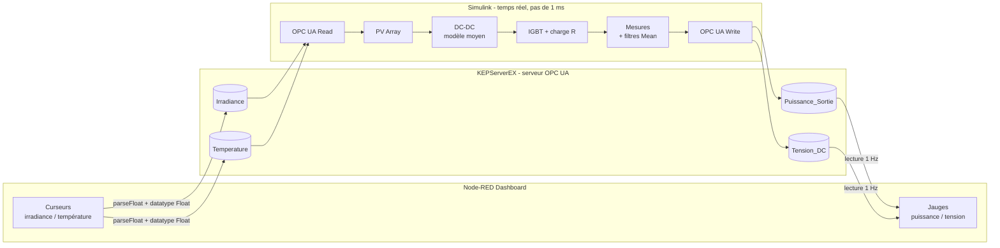

# Jumeau numérique d'un système photovoltaïque

**Modèle Simulink temps réel connecté en OPC UA à une IHM Node-RED, avec une analyse RAMI 4.0**
MATLAB/Simulink · Simscape Electrical · KEPServerEX · OPC UA · Node-RED


> Projet académique (ENSAM Meknès, 2025 – 2026). Il est réalisé en deux parties :
> 1. une **analyse RAMI 4.0** d'un système de supervision photovoltaïque ;
> 2. la **conception et la mise en œuvre d'un jumeau numérique** interactif, en boucle fermée.

---

## Objectif

Un jumeau numérique n'est pas une simple simulation hors ligne : c'est une réplique virtuelle **dynamique,
connectée et synchronisée**. Ici, un opérateur modifie l'irradiance et la température depuis une page web.
Ces consignes passent par OPC UA jusqu'au modèle Simulink, qui recalcule en temps réel la puissance et la
tension produites, puis les renvoie à l'IHM.

## Architecture en boucle fermée



## Chaîne de conversion modélisée (Simscape Electrical)

| Étage | Modélisation | Choix d'ingénierie |
|---|---|---|
| Générateur PV | Bloc `PV Array` (caractéristiques I-V et P-V non linéaires) | Entrées irradiance et température reçues en OPC UA, séparées par un `Bus Selector` ; condensateur de bus continu |
| Adaptation DC-DC | `Average-Value DC-DC Converter` | Modèle en valeur moyenne : supprime le calcul des commutations haute fréquence tout en gardant la dynamique tension/courant |
| Découpage et charge | IGBT commandé en PWM, charge résistive | Représente une charge commutée ou l'étage primaire d'un onduleur |
| Mesure | Capteurs de courant et de tension, `Product` (P = U × I) | Filtres moyenneurs `Mean` avant publication OPC UA |

## Tags OPC UA (KEPServerEX)

Canal `simulation_PV` (driver Simulator), équipement `jumeau_matlab`, type **Float** imposé.

| Tag | Adresse | Sens | Unité |
|---|---|---|---|
| `Irradiance` | R0001 | IHM → Simulink | W/m² |
| `Temperature` | R0002 | IHM → Simulink | °C |
| `Puissance_Sortie` | R0003 | Simulink → IHM | W |
| `Tension_DC` | R0004 | Simulink → IHM | V |

NodeId côté client : `ns=2;s=simulation_PV.jumeau_matlab.<Tag>`.
Détails de configuration : [`docs/kepserverex-config.md`](docs/kepserverex-config.md).

---

## Difficultés techniques résolues

### 1. Simulation temps réel et théorème de Shannon
Pour qu'un jumeau numérique dialogue avec un réseau industriel, une seconde simulée doit durer une seconde réelle.
Avec un solveur discret au pas de **1 ms** (1 000 Hz), la porteuse PWM de l'IGBT (plus de 1 600 Hz) dépassait la
fréquence de Nyquist de 500 Hz. Le solveur ne voyait plus les impulsions : l'IGBT restait ouvert et la
puissance calculée était nulle.
**Solution** : abaisser la fréquence de la porteuse PWM sous la limite de Nyquist du pas de calcul, en gardant
l'architecture physique avec IGBT.

### 2. Signaux hachés illisibles en supervision
Le découpage de l'IGBT faisait osciller la tension et la puissance entre 0 et la valeur crête.
**Solution** : des blocs `Mean` calculent la valeur moyenne sur la période fondamentale avant l'écriture OPC UA.
Les jauges deviennent lisibles et la charge réseau diminue.

### 3. Bus virtuel Simulink et entrées scalaires
Le bloc `OPC UA Read` produit un bus virtuel, alors que le bloc `PV Array` attend des scalaires
(erreur *« Nonbus signal expected »*).
**Solution** : un `Bus Selector` sépare l'irradiance et la température vers les ports `Ir` et `T`.

### 4. Typage IT/OT : String contre Float
Les curseurs web de Node-RED envoient des chaînes de caractères, alors que les tags KEPServerEX sont en Float.
Le serveur rejette l'écriture (*Type Mismatch*).
**Solution** : un nœud `function` convertit et type explicitement la valeur
([`nodered/functions/`](nodered/functions/)) :

```javascript
msg.payload = { value: parseFloat(msg.payload), datatype: "Float" };
msg.topic = "ns=2;s=simulation_PV.jumeau_matlab.Irradiance";
return msg;
```

---

## Analyse RAMI 4.0

Le système de supervision solaire (panneau, batterie, régulateur PWM, microcontrôleur, passerelle ESP32,
capteurs INA219, relais et MOSFET, écran LCD) est positionné sur les trois axes du cube RAMI 4.0 :

- **Hiérarchie** (IEC 62264 / IEC 61512) : du produit (l'énergie produite) jusqu'au monde connecté (cloud, réseau électrique, météo) ;
- **Couches** : de l'actif physique jusqu'à la valeur métier (optimisation énergétique, maintenance prédictive) ;
- **Cycle de vie** (IEC 62890) : distinction entre le *Type* (conception, firmware versionné) et l'*Instance* (exploitation, maintenance, fin de vie).

Analyse complète : [`docs/rami40-analysis.md`](docs/rami40-analysis.md).

---

## Sécurité OT

Pour ce prototype en boucle locale fermée (`opc.tcp://127.0.0.1:49320`), l'endpoint OPC UA a été configuré en
**`None` (sans signature ni chiffrement) avec connexion anonyme**. Les certificats par défaut provoquaient des
rejets de connexion avec MATLAB (`Basic256`).

C'est acceptable sur une machine isolée, **pas sur un réseau industriel**. Pour un déploiement réel :
- endpoint **Basic256Sha256 en Sign & Encrypt**, avec désactivation des politiques obsolètes (`None`, `Basic128Rsa15`, `Basic256`) ;
- échange et approbation explicite des certificats clients (Simulink, Node-RED) dans *Trusted Clients* ;
- authentification par utilisateur, avec des droits en lecture seule sur les mesures et en écriture limitée aux consignes ;
- endpoint lié à l'interface de la zone de supervision uniquement, filtré par pare-feu (zones et conduits IEC 62443).

## Reproduire le projet

**Prérequis** : MATLAB/Simulink avec Simscape Electrical et Industrial Communication Toolbox ; KEPServerEX 6 ;
Node-RED avec `node-red-contrib-opcua` et `node-red-dashboard`.

1. Configurer KEPServerEX selon [`docs/kepserverex-config.md`](docs/kepserverex-config.md).
2. Ouvrir le modèle dans [`simulink/`](simulink/), sélectionner le serveur dans les blocs `OPC UA Read` et `OPC UA Write`, puis lancer la simulation.
3. Importer le flow Node-RED ([`nodered/`](nodered/)) et ouvrir le dashboard (`http://localhost:1880/ui`).
4. Faire varier l'irradiance (0 à 1 200 W/m²) et observer la puissance et la tension mises à jour en temps réel.

## Structure du dépôt

```
├── simulink/       Modèle Simulink (.slx) et paramètres de simulation
├── nodered/        Fonctions de formatage OPC UA et documentation du flow
├── docs/           Analyse RAMI 4.0, configuration KEPServerEX, captures
└── README.md
```

## Perspectives

- Remplacer le rapport cyclique fixe par une **commande MPPT** (Perturb & Observe ou incrémentale).
- Comparer en continu les mesures réelles de l'ESP32 au modèle pour **détecter les pertes de performance**
  (encrassement, dérive des capteurs, vieillissement).
- Historiser les données dans InfluxDB et les analyser avec Grafana.
- Sécuriser l'endpoint OPC UA (voir la section Sécurité OT).

---

**Auteur** : Abderrahmane Chabaoui, élève ingénieur Électromécanique et Digitalisation Industrielle, ENSAM Meknès
· [LinkedIn](https://www.linkedin.com/in/abderrahmane-chabaoui)
